<p align="center">
  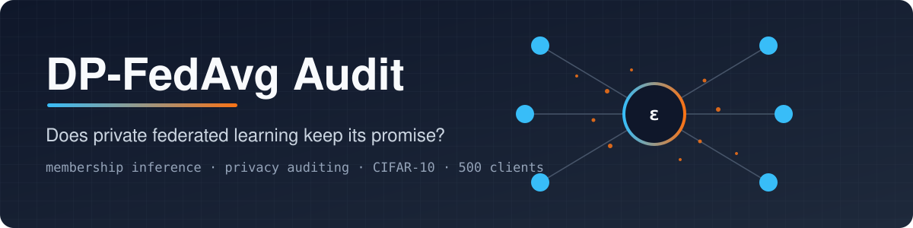
</p>

<p align="center">
  <a href="https://github.com/sh4shv4t/dp-fedavg-audit/actions/workflows/tests.yml"></a>
  <a href="https://colab.research.google.com/github/sh4shv4t/dp-fedavg-audit/blob/main/notebooks/DP_FedAvg_MIA_Audit.ipynb"></a>
  
  
  
  
</p>

<p align="center">Auditing differentially private federated learning with membership inference and canary clients</p>

---

## TL;DR

DP-FedAvg hands you a privacy number, ε, that promises how little anyone can learn about a single client. We wanted to check that promise with real attacks, and to see if an audit can catch a DP implementation that is quietly broken.

| | No DP (FedAvg) | z = 0.5 | z = 1 | z = 2 | z = 4 |
|---|:---:|:---:|:---:|:---:|:---:|
| **Claimed ε** (RDP accountant, upper bound) | ∞ | 35.23 | 7.90 | 2.58 | 1.08 |
| **Canary audit, ε estimate** | 73 | 9.73 | 4.33 | 1.95 | 0.89 |
| **Canary audit, proven ε** (95% lower bound) | 5.61 | 3.83 | 1.42 | 0.27 | 0 |
| **LiRA on images, proven ε** | 0.36 | 0.04 | 0 | 0 | 0 |
| **Test accuracy** | 54.1% | 44.0% | 34.8% | 25.0% | 14.1% |

Mean over 3 seeds. The big takeaways:

- **The promise holds.** Nothing we threw at it beat the claimed ε. The canary audit lands surprisingly close though: at z = 2 the estimate is 1.95 against a claim of 2.58.
- **Attacking images on the final model barely proves anything.** Even the strongest one (LiRA) proves ε ≥ 0.36 on a model with no DP at all. Planting canary clients is the audit that actually has teeth.
- **The audit catches a real bug.** We broke the noise on purpose (added it to the mean instead of the sum, so it is 50x too small). The accountant still says ε = 2.58. The canary audit proves ε ≥ 5.6 and blocks it.
- **The accuracy cost is a "not enough clients" problem.** Keep ε fixed and go from 50 to 500 clients per round and the z = 1 model catches up with plain FedAvg (44.8% vs 43.9%).

## How it works

<p align="center">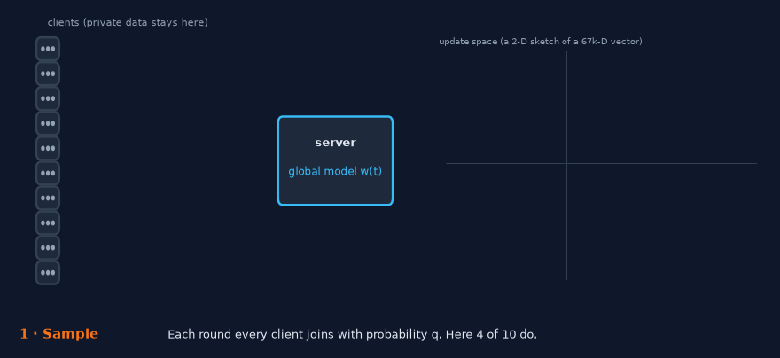</p>

Federated learning keeps raw data on the device and only ships model updates to a server. Sounds private, but a trained model is still a tad bit more confident on the things it trained on. A **membership inference attack** uses exactly that to guess if a record (or a whole client) was part of training. And "your data was used to train this" can itself be the private bit.

DP-FedAvg patches this in each round:

1. **Sample** every client with probability q = 0.1
2. **Train** locally for a few epochs
3. **Clip** every update to L2 norm C, so no single client can shout louder than the rest
4. **Sum** the clipped updates
5. **Add Gaussian noise** with std z·C to the sum
6. **Share** the noisy average as the new global model

A privacy accountant turns `(z, q, rounds, δ)` into an (ε, δ) guarantee. That ε is a worst-case **upper bound**. Our audits try to push up from below.

## Real world use cases

<p align="center">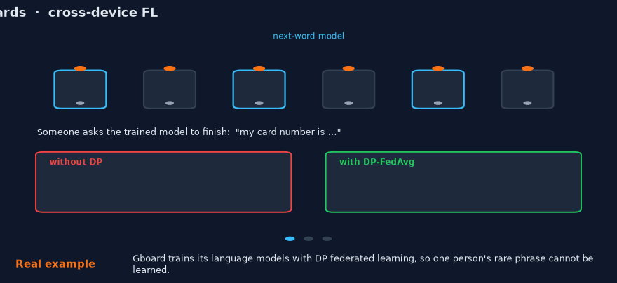</p>

- **Phone keyboards.** Next-word prediction models are trained with DP federated learning across millions of phones (Gboard does this in production). Each phone is one client, so a client-level ε is exactly the guarantee you want: your typing as a whole stays hidden, not just one sentence.
- **Hospitals.** A few hospitals train a shared diagnosis model without pooling patient records. ε puts a hard cap on how sure an attacker can get that a patient was in the data. With a 50/50 prior, ε = 1.08 caps them at 75% confidence. ε = 7.90 caps them at 99.96%, which is pretty much no cap. That gap is why the actual number matters.
- **A release gate for any FL team.** DP code is easy to get subtly wrong and the accountant can't tell. Plant canary clients, measure how loud they come through and block the release if the measured ε beats the claimed one. That is precisely how we caught the planted bug below.

## What we ran

| Piece | Choice |
|---|---|
| Data | CIFAR-10. 10k members (training data), 10k non-members (attack ground truth), 10k test, rest kept as a pool for reference models |
| Clients | 500 IID clients, 20 images each, Poisson sampled with q = 0.1 (about 50 per round) |
| Model | 3-layer CNN with GroupNorm, 66,890 parameters |
| Training | 100 rounds, 5 local epochs, batch 10, local lr 0.05, server lr 1.0 |
| Configs | FedAvg, Clip-only (C = 1), DP-FedAvg with z ∈ {0.5, 1, 2, 4}, plus a deliberately buggy z = 2 |
| Seeds | 3 per config |
| Accounting | Rényi DP accountant (Opacus, the claimed ε) and the GDP central limit approximation (Bu et al.) |
| Record attacks | Loss threshold, calibrated loss and offline LiRA with 4 reference models per config |
| Client audit | 200 canary clients per run plus 2000 never-inserted directions as a null |
| Proven ε | `TPR ≤ e^ε · FPR + δ` with Clopper-Pearson intervals and a Bonferroni correction |

Everything is 18 main runs, 24 reference runs, 21 canary runs and 12 scaling runs. The whole suite takes about 1.5 hours on a laptop RTX 3050.

## Results

### 1. Stronger attacks on images

<p align="center">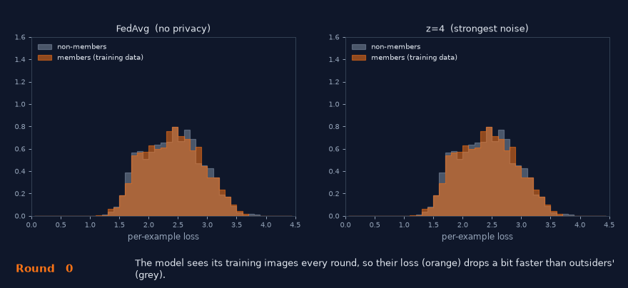</p>

That animation uses real per-example losses from our runs. Without DP the members' losses slide left faster than the outsiders'. At z = 4 the two piles stay on top of each other and the attack is a coin flip.

| config | test acc | loss AUC | LiRA AUC | LiRA TPR @ 1% FPR | proven ε (loss) | proven ε (LiRA) |
|---|---:|---:|---:|---:|---:|---:|
| FedAvg | 54.1% | 0.548 | 0.587 | 2.0% | 0.004 | 0.355 |
| Clip-only | 54.2% | 0.548 | 0.588 | 1.8% | 0.019 | 0.364 |
| z = 0.5 | 44.0% | 0.529 | 0.534 | 1.2% | 0.003 | 0.036 |
| z = 1 | 34.8% | 0.518 | 0.516 | 1.2% | 0 | 0 |
| z = 2 | 25.0% | 0.511 | 0.508 | 1.1% | 0 | 0 |
| z = 4 | 14.1% | 0.503 | 0.505 | 1.0% | 0 | 0 |

Calibrating each image against reference models that never saw it makes the attack about **90x stronger** in proven ε for FedAvg (0.004 to 0.355). Some images are just hard, and a raw loss threshold can't tell "hard" from "never seen". Still, at a strict 1% false alarm rate even LiRA only catches 2% of members. Full table in [`results/attacks.csv`](results/attacks.csv).

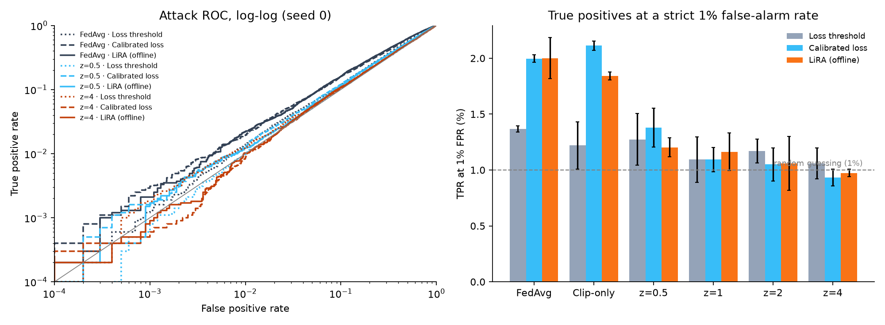

### 2. The canary audit

<p align="center">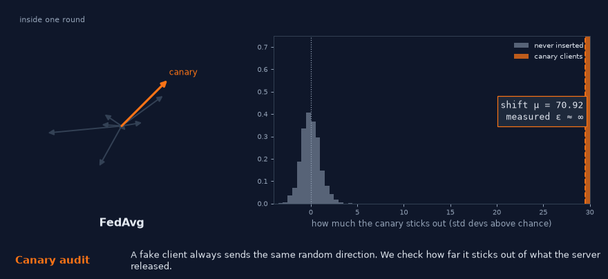</p>

A canary is a fake client that always sends the same random direction, scaled to the clip norm, every time it is sampled. Afterwards we check how much each canary direction sticks out of what the server released, compared with directions that were never inserted. The shift between the two piles (μ, in standard deviations) maps straight to an ε through Gaussian DP. This tests the client-level guarantee directly, which is what the accountant actually promises.

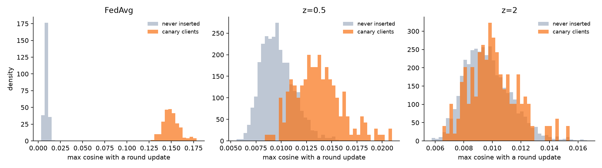

### 3. The ε ladder

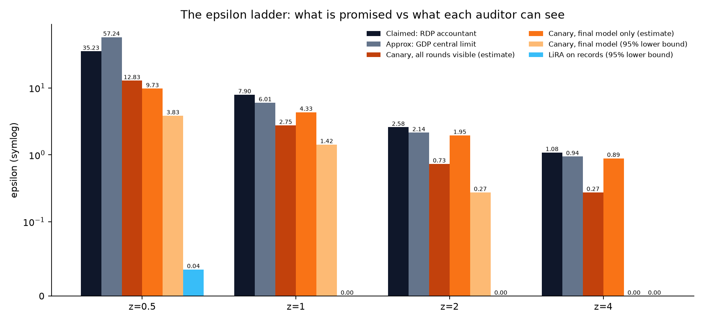

From top to bottom of each group: what's promised, what the GDP approximation says, what canaries estimate and what canaries and LiRA can prove at 95% confidence. Every measured value stays under the claim, so no violations. The canary estimate tracks the claim well at z = 2 and z = 4 and gets looser at low noise, which is where the RDP bound itself is loosest (the CLT value is 57 vs 35 at z = 0.5, so even the two theory numbers disagree there).

One surprise: we expected the "all rounds visible" attacker to win, since it sees more. It didn't. Each round's cosine is diluted by about 50 other clients plus the noise, while the final model piles up every round a canary showed up in.

### 4. Catching a broken implementation

We added one bug, the kind that slips through code review: the noise gets divided by the number of clients, as if it were added to the average instead of the sum.

| | claimed ε | canary μ | proven ε | test acc | verdict |
|---|---:|---:|---:|---:|---|
| z = 2 (correct) | 2.58 | 0.49 | 0.27 | 25.6% | ship |
| z = 2 (buggy) | 2.58 | 8.23 | **5.62** | 53.8% | **block** |

The accountant can't see it, its inputs are the same. The canaries can. The buggy model also suspiciously matches FedAvg accuracy, which is a nice extra smell test. 5.6 is about as high as 200 canaries can prove at 95% confidence (FedAvg with no noise at all hits the same ceiling). Proving more would just need more canaries.

### 5. Scaling: same ε, more clients

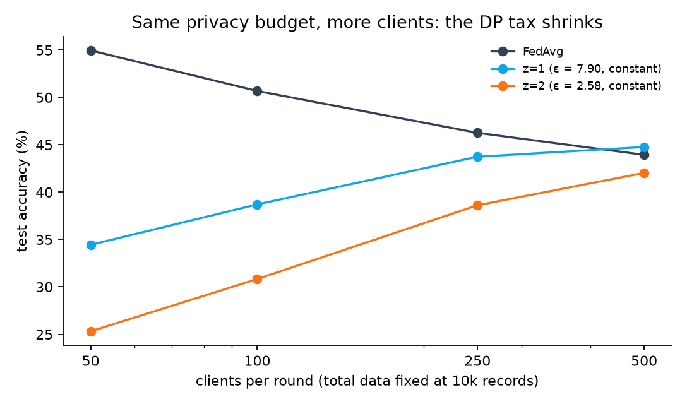

Total data stays fixed at 10k images, so more clients means fewer images each. The noise on the averaged update shrinks like 1/(clients per round) while ε stays put.

| clients per round | FedAvg | z = 1 (ε 7.90) | z = 2 (ε 2.58) |
|---:|---:|---:|---:|
| 50 | 55.0% | 34.4% | 25.3% |
| 100 | 50.7% | 38.7% | 30.8% |
| 250 | 46.3% | 43.7% | 38.6% |
| 500 | 43.9% | 44.8% | 42.0% |

At 500 clients per round the DP tax at ε = 7.90 is basically gone. This is why real deployments run with thousands of clients per round and why our 50-client setup looked so expensive.

## Interpretability: what leaks and why

**Who leaks.** The most exposed training images are the odd ones out: a blurry close-up of a bird, a ship on a white background, a plane head on. The least exposed are textbook examples like a horse on a green field. The model has to memorise the weird ones to fit them.

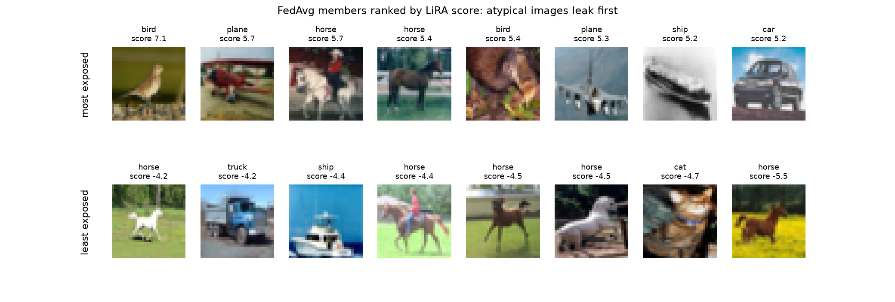

**Hard images leak more.** Bucketing members by how hard they are for models that never saw them, leakage goes from AUC 0.56 for easy images to about 0.62 for hard ones.

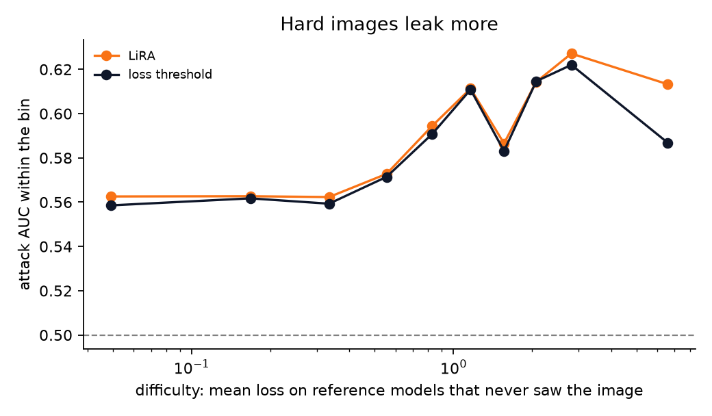

**Per class.** Frogs, dogs and deer leak the most under LiRA, ships the least. Loss threshold ranks classes quite differently (planes look safe to it), which is another sign it measures difficulty as much as membership.

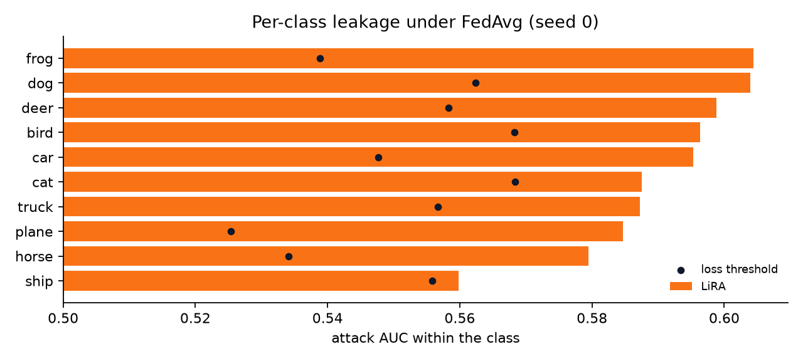

**Why accuracy collapses.** The left panel is the size of the summed clipped updates over the size of the noise, per round. It never gets above 0.16 and sits around 0.02 to 0.05 for most of training. The noise is 6 to 100 times louder than the signal. Leakage and the train/test gap grow steadily without DP and stay flat with it.

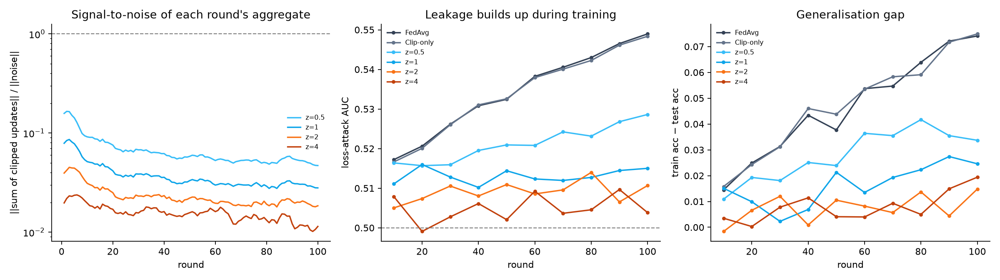

**Why Clip-only matches FedAvg.** Median client updates settle below C = 1 after a few rounds, so clipping touches only about 13% of updates without noise. With heavy noise the global model is worse, updates grow and about half of them get clipped.

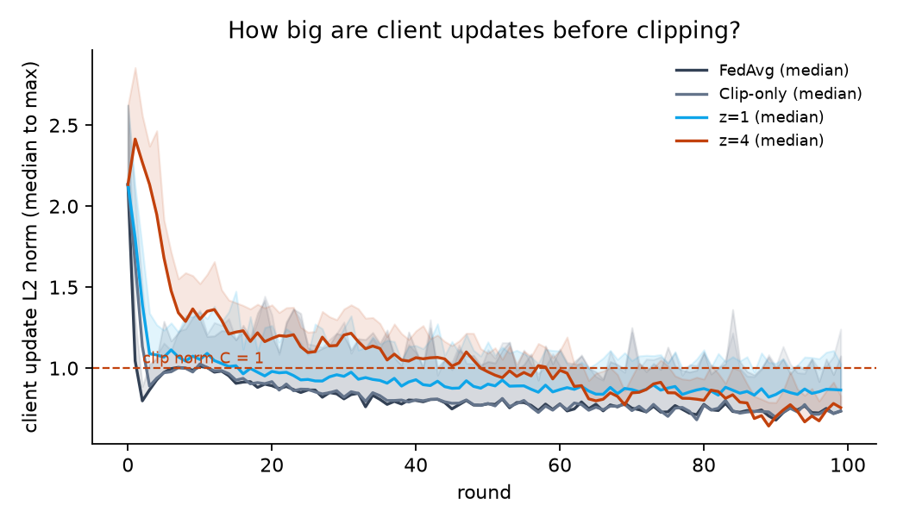

## The code

The notebook trained clients one at a time. The `dpfl_audit` package trains all sampled clients in a round at once: the CNN is called functionally with `torch.func`, per-client gradients come from `vmap(grad(loss))` and SGD runs on a stacked `[K, ...]` copy of the weights. Same maths (a test checks it matches the notebook's loop), one batched kernel per layer instead of K.

One round of local training on an RTX 3050 laptop GPU ([`results/benchmark.json`](results/benchmark.json)):

| clients | notebook loop | vmap | speedup |
|---:|---:|---:|---:|
| 10 | 346 ms | 139 ms | 2.5x |
| 50 | 1683 ms | 565 ms | 3.0x |
| 100 | 3413 ms | 1103 ms | 3.1x |
| 250 | 10789 ms | 2500 ms | 4.3x |
| 500 | 18005 ms | 5189 ms | 3.5x |

That's what made 75 full training runs on a laptop practical.

## Run it yourself

```bash
git clone https://github.com/sh4shv4t/dp-fedavg-audit && cd dp-fedavg-audit
pip install -r requirements.txt
pytest -q                                   # 11 tests, CPU is fine
python scripts/run_experiments.py all       # every run, about 1.5 h on a small GPU, resumable
python scripts/run_experiments.py bug       # the buggy-noise audit
python scripts/analyze.py                   # tables in results/, figures in figures/
python scripts/make_animations.py           # GIFs in assets/
python scripts/bench.py                     # vmap vs loop timings
```

Add `--quick` to `run_experiments.py` for a 10-round smoke test. All raw runs are already committed in `results/raw/`, so `analyze.py` and `make_animations.py` work straight after cloning.

Prefer a notebook? The Colab badge up top opens the original single-notebook version (6 configs × 3 seeds, loss attack only).

**Heads up on data:** CIFAR-10 is pulled from the Hugging Face mirror because the official server was crawling. Its image order differs from the original batches, so our split isn't image-for-image the notebook's. It's statistically the same and the FedAvg numbers line up (54.9% vs 53.8% test accuracy, AUC 0.549 vs 0.544 on seed 0).

## Repo layout

```
dpfl_audit/            the package: config, data, model, vmap FL loop, attacks, canaries, accounting
scripts/               run_experiments, analyze, make_animations, bench
tests/                 equivalence, accounting and attack sanity tests (run in CI)
results/               result tables + every raw run (results/raw)
figures/               all plots
assets/                banner and animations
notebooks/             the original notebook, with outputs
docs/                  plain-English report and a talk outline
```

## Limitations

- One dataset, one small CNN, IID clients.
- Central DP with a trusted server, no secure aggregation.
- Canary clients send a fixed direction, the classic worst-case setup. Real clients are a lot gentler, so real leakage is lower than the canary numbers.
- The canary ε estimate is a point estimate from a Gaussian fit, not a bound. The proven ε is the rigorous one.
- The scaling study uses one seed per point.

## What's next

- [ ] Non-IID partitions (Dirichlet), closer to real deployments
- [ ] More canaries to lift the 5.6 ceiling on proven ε
- [ ] Gradient-crafted canaries instead of random directions
- [ ] Secure aggregation and distributed noise

## References

- McMahan et al., *Communication-Efficient Learning of Deep Networks from Decentralized Data*, AISTATS 2017 (FedAvg)
- McMahan et al., *Learning Differentially Private Recurrent Language Models*, ICLR 2018 (DP-FedAvg)
- Mironov, *Rényi Differential Privacy*, CSF 2017
- Dong, Roth and Su, *Gaussian Differential Privacy*, JRSS-B 2022
- Bu, Dong, Long and Su, *Deep Learning with Gaussian Differential Privacy*, HDSR 2020
- Yeom et al., *Privacy Risk in Machine Learning: Analyzing the Connection to Overfitting*, CSF 2018
- Watson et al., *On the Importance of Difficulty Calibration in Membership Inference Attacks*, ICLR 2022
- Carlini et al., *Membership Inference Attacks From First Principles*, IEEE S&P 2022 (LiRA)
- Jagielski et al., *Auditing Differentially Private Machine Learning: How Private is Private SGD?*, NeurIPS 2020
- Nasr et al., *Adversary Instantiation: Lower Bounds for Differentially Private Machine Learning*, IEEE S&P 2021
- Andrew et al., *One-shot Empirical Privacy Estimation for Federated Learning*, ICLR 2024
- Xu et al., *Federated Learning of Gboard Language Models with Differential Privacy*, ACL Industry 2023

## Team

| Name | GitHub |
|---|---|
| Vasu Sharma | [@vsh9705](https://github.com/vsh9705) |
| Shashvat Singh | [@sh4shv4t](https://github.com/sh4shv4t) |
| Adya Sharma | [@adya76](https://github.com/adya76) |

## License

[MIT](LICENSE)
