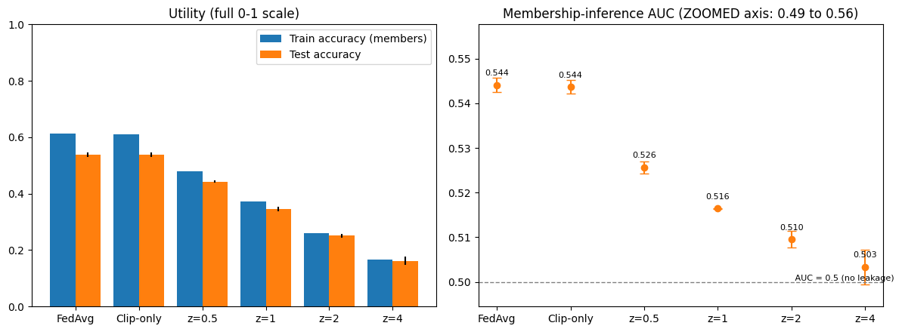
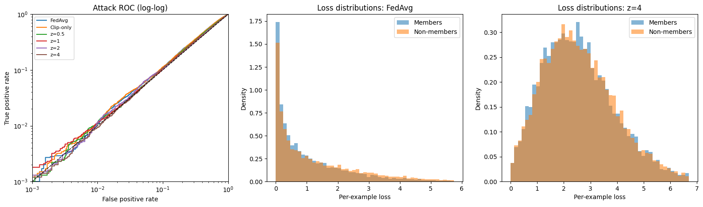
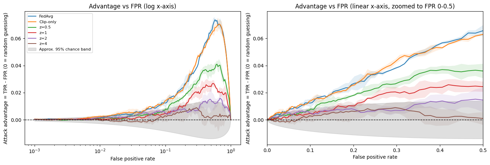
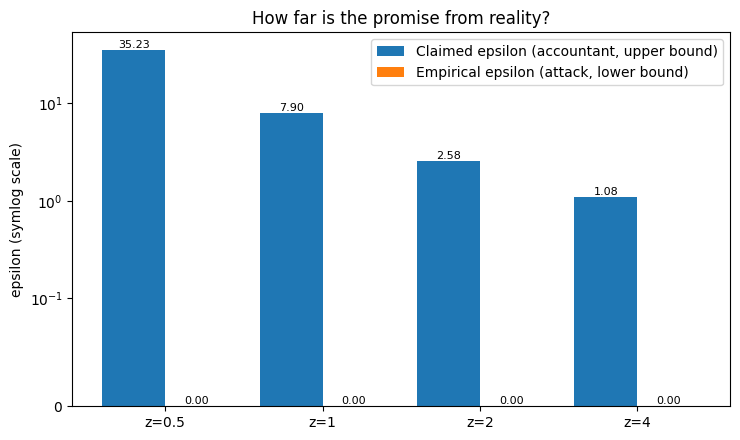

<p align="center">
  
</p>

<p align="center">
  <a href="https://colab.research.google.com/github/sh4shv4t/dp-fedavg-audit/blob/main/notebooks/DP_FedAvg_MIA_Audit.ipynb"></a>
  
  
  
  
  
</p>

<p align="center"><b>FLTDI course project</b> · auditing differentially private federated learning with membership inference attacks</p>

---

## TL;DR

DP-FedAvg hands you a privacy number, ε, that promises how little an attacker can learn about any one client. We wanted to check that promise against a real attack.

| | No DP (FedAvg) | z = 0.5 | z = 1 | z = 2 | z = 4 |
|---|:---:|:---:|:---:|:---:|:---:|
| **Claimed ε** (accountant, upper bound) | ∞ | 35.23 | 7.90 | 2.58 | 1.08 |
| **Empirical ε** (attack, lower bound) | 0.002 | 0.00 | 0.00 | 0.00 | 0.00 |
| **Attack AUC** (0.5 = coin flip) | 0.544 | 0.526 | 0.516 | 0.510 | 0.503 |
| **Test accuracy** | 53.8% | 44.3% | 34.6% | 25.1% | 16.2% |

- **Noise works in the right direction.** More noise pushes the attack closer to a coin flip, in the same order as the promised ε.
- **It costs a lot of accuracy.** With only ~50 clients per round the noise drowns out the signal: 54% down to 16%.
- **The promise and the measurement are far apart.** The accountant claims ε between 1.08 and 35.23. Our loss-threshold attack could prove basically nothing. That does not mean the promise is wrong. It means a final-model, loss-based attack is way too weak to stress it.

## The problem

Federated learning keeps raw data on the device and only ships model updates to a server. Sounds private, but a trained model still tends to be a tad bit more confident on the examples it trained on. A **membership inference attack (MIA)** uses exactly that to guess whether a record was in the training set. And "your data was used to train this" can itself be the private bit.

**DP-FedAvg** fixes this in two steps:

1. **Clip** every client update to an L2 norm of at most `C`, so no one client can shout louder than the rest.
2. **Add Gaussian noise** with standard deviation `z · C` to the aggregated sum, just enough to hide any one client.

A privacy accountant then turns `(z, q, T, δ)` into an (ε, δ) guarantee. That ε is a worst-case **upper bound**. Our question: how close does a practical attacker get to it?

## Method

```
          ┌────────────── 100 rounds ──────────────┐
500 clients ── Poisson sample (q = 0.1) ──> ~50 clients
   (20 CIFAR-10 images each)                  │ 5 local epochs, SGD
                                              ▼
                                   update Δ_k = w_local − w_global
                                              │ clip to ‖Δ‖ ≤ C
                                              ▼
                         server: Σ Δ_k  +  N(0, z²C²I)   ──>  w_global
                                              │
             ┌────────────────────────────────┴───────────────────────┐
             ▼                                                        ▼
   RDP accountant (Opacus) ──> claimed ε             loss-threshold MIA on final model
                                                     10k members vs 10k non-members
                                                     ──> AUC, TPR@FPR, empirical ε
```

| Piece | Choice |
|---|---|
| Data | CIFAR-10, fixed split: 10k members (train), 10k non-members (attack ground truth), 10k test |
| Clients | 500 IID clients, 20 records each, sampled with probability q = 0.1 per round |
| Model | 3-layer CNN with GroupNorm (BatchNorm mixes samples, so it does not play well with DP) |
| Training | 100 rounds, 5 local epochs, batch 10, local lr 0.05, server lr 1.0 |
| Configs | FedAvg, Clip-only (C = 1), DP-FedAvg with z ∈ {0.5, 1, 2, 4} |
| Seeds | 3 per config (0, 1, 2), mean ± std reported |
| Theoretical ε | Rényi DP accountant for the subsampled Gaussian mechanism, δ = 1e-5 |
| Attack | Loss threshold: lower per-example loss means "member" |
| Empirical ε | From the DP hypothesis-testing bound `TPR ≤ e^ε · FPR + δ`, using Clopper-Pearson intervals with a Bonferroni correction over 8 thresholds |

## Results

Full table (mean ± std over 3 seeds) is in [`results/results_table.csv`](results/results_table.csv).

| config | ε theory | test acc | train acc | AUC | TPR@1% FPR | TPR@10% FPR | advantage | ε empirical |
|---|---:|---|---|---|---|---|---|---|
| FedAvg | ∞ | 0.538 ± 0.008 | 0.613 ± 0.006 | 0.544 ± 0.002 | 0.012 ± 0.001 | 0.113 ± 0.003 | 0.077 ± 0.001 | 0.002 ± 0.002 |
| Clip-only | ∞ | 0.538 ± 0.008 | 0.611 ± 0.009 | 0.544 ± 0.002 | 0.013 ± 0.001 | 0.114 ± 0.001 | 0.074 ± 0.002 | 0.001 ± 0.001 |
| z = 0.5 | 35.23 | 0.443 ± 0.004 | 0.480 ± 0.009 | 0.526 ± 0.001 | 0.011 ± 0.002 | 0.108 ± 0.002 | 0.044 ± 0.003 | 0.000 ± 0.000 |
| z = 1 | 7.90 | 0.346 ± 0.007 | 0.373 ± 0.004 | 0.516 ± 0.000 | 0.011 ± 0.001 | 0.105 ± 0.003 | 0.031 ± 0.001 | 0.000 ± 0.000 |
| z = 2 | 2.58 | 0.251 ± 0.006 | 0.261 ± 0.003 | 0.510 ± 0.002 | 0.012 ± 0.001 | 0.105 ± 0.000 | 0.020 ± 0.004 | 0.000 ± 0.000 |
| z = 4 | 1.08 | 0.162 ± 0.015 | 0.165 ± 0.018 | 0.503 ± 0.004 | 0.010 ± 0.000 | 0.103 ± 0.004 | 0.013 ± 0.005 | 0.000 ± 0.000 |

### Utility vs leakage
Accuracy drops hard as noise goes up, while attack AUC slides towards 0.5. Heads up: the right panel is on a zoomed axis, every AUC sits between 0.50 and 0.55.



### ROC and loss distributions
Member and non-member losses overlap heavily even for plain FedAvg (train 61% vs test 54%, so not much memorization). At z = 4 the two histograms are basically the same.



### Attack advantage (TPR − FPR)
FedAvg peaks around 7 points above guessing, z = 0.5 around 4, z = 1 around 2.5, z = 2 around 1.5. z = 4 never leaves the 95% chance band. The ordering matches the ordering of the promised ε, which is a good sign. At low FPR, where attacks actually matter, even FedAvg barely beats guessing.



### The audit gap
Claimed ε vs what the attack could prove. Nothing breaks the promise, but nothing gets close to it either.



## Why the gap?

- **The guarantee is worst case.** It covers an attacker who sees every round and picks the nastiest possible data. We attacked only the final model with ordinary images.
- **The model barely memorized.** With a 61% / 54% train/test split there just is not much to find.
- **Few clients per round.** ~50 clients per round with ~67k parameters means the noise dominates. That explains the accuracy hit, and it is also why real deployments use thousands of clients.

## Limitations

- One dataset, one small CNN, IID clients.
- One attack (loss threshold), no planted canaries.
- Trusted server adds the noise (central DP, not local or distributed DP).
- ROC and histogram figures show seed 0 only. Everything else averages 3 seeds.
- The accountant's ε is a **client-level** guarantee (which also covers any single record). Our attack only tests single records on the final model, which is a much easier bar for the defence to clear than testing a whole client.

## Next steps

- [ ] Stronger attack: LiRA (likelihood ratio attack, Carlini et al. 2022) with shadow models
- [ ] Client-level canaries: plant crafted clients and audit the user-level guarantee directly
- [ ] Observe intermediate updates (white-box, per-round attacker)
- [ ] Scale clients per round to see how much of the accuracy cost goes away
- [ ] Non-IID partitions (Dirichlet), closer to real deployments

## Run it yourself

The easy way is Colab: hit the badge at the top, switch the runtime to a **T4 GPU** and run top to bottom.

- Set `QUICK = True` in Cell 2 first for a ~5 minute smoke test, then `QUICK = False` for the full run (~40 to 60 minutes, 6 configs × 3 seeds).
- `USE_DRIVE = True` saves results to Google Drive so a disconnect does not kill the run. Finished runs are skipped on re-run.
- Running locally? Set `USE_DRIVE = False` and `pip install -r requirements.txt`.

## Repo layout

```
notebooks/DP_FedAvg_MIA_Audit.ipynb   the full experiment (with outputs)
results/results_table.csv             final numbers, mean ± std over 3 seeds
figures/                              all plots from the notebook
docs/DP_FedAvg_Plain_English_Report.docx   plain-English write-up
docs/PRESENTATION.md                  talk outline for the project presentation
```

## References

- McMahan et al., *Learning Differentially Private Recurrent Language Models*, ICLR 2018 (DP-FedAvg)
- McMahan et al., *Communication-Efficient Learning of Deep Networks from Decentralized Data*, AISTATS 2017 (FedAvg)
- Mironov, *Rényi Differential Privacy*, CSF 2017
- Yeom et al., *Privacy Risk in Machine Learning: Analyzing the Connection to Overfitting*, CSF 2018 (loss-threshold MIA)
- Jagielski et al., *Auditing Differentially Private Machine Learning: How Private is Private SGD?*, NeurIPS 2020
- Nasr et al., *Adversary Instantiation: Lower Bounds for Differentially Private Machine Learning*, IEEE S&P 2021
- Carlini et al., *Membership Inference Attacks From First Principles*, IEEE S&P 2022 (LiRA)

## License

[MIT](LICENSE)
